# Local integrated system

The repository root `docker-compose.yml` is the canonical local stack. It starts
CTEM, Workflow, Notification API, in-app/retry/DLQ workers, Kafka, MySQL, PostgreSQL,
Redis, Kafka UI, and Mailpit. Kafka topics for all notification channels, retry,
and dead-letter delivery are initialized on startup. MySQL is published on host port 3307, PostgreSQL
on 5433, Redis on 6380, and Mailpit on 1026/8026 to avoid the earlier local
MySQL and Mailpit containers. Mailpit stores its mailbox in a named volume.

## Start and inspect

From the repository root:

```powershell
docker compose config
docker compose up --build -d
docker compose ps
```

Open CTEM at `http://localhost:8000/docs`, Workflow at
`http://localhost:8001/docs`, Notification at `http://localhost:3000/health`,
Kafka UI at `http://localhost:8080`, and Mailpit at `http://localhost:8026`.
The containers use their internal service ports; the alternate ports above are
only for host access.

## CTEM to Workflow to Notification

Create a Workflow through `POST /workflows` with a tenant UUID and an event
trigger. For example, use this `triggers` value:

```json
[{"type":"event","event":"ExposureDetected","filter":"severity == 'critical'"}]
```

Set its definition to include one action step:

```json
{"steps":[{"id":"notify","name":"Notify owner","type":"action","action":"send_notification","input":{"channel":"in-app","recipient":"local-test-user","template":"security-alert"}}],"connections":[]}
```

Then create an exposure using the same `tenant_id` at
`POST /ctem/cycles/1/exposures`. Include `user_id` if the action should use the
trigger's user as its recipient; a recipient in the step input takes priority.
The exposure and its outbox event are saved in one database transaction. CTEM
publishes outbox events to Kafka with retries; Workflow consumes only active
workflows for the same tenant, applies the event filter, and starts an
idempotent execution. The Notification API publishes the in-app notification
and the worker records its delivery status. Check `GET /notifications` or
`GET /notifications/inapp/local-test-user` for the result.

## Email report check

The stack routes report email to Mailpit (`mailpit:1025`, no TLS). Open
`http://localhost:8026` to inspect messages. The named volume preserves the
inbox across container restarts. This verifies SMTP delivery to the local test
mail server, not delivery through Gmail.

For Gmail delivery, configure the ignored root `.env` with a Gmail App Password
and the account address as `SMTP_FROM` and `SMTP_USERNAME`. Keep the password
only in `.env`; do not paste it into chat or commit it. Start the Gmail-specific
configuration with:

```powershell
docker compose -f docker-compose.yml -f docker-compose.gmail.yml up -d --force-recreate ctem-api
```

Create a one-time report schedule addressed to the `SMTP_FROM` mailbox. After
the check, return the CTEM API to Mailpit configuration with:

```powershell
docker compose up -d --force-recreate ctem-api
```

## Current boundaries

- Exposure events are emitted only when the CTEM request includes `tenant_id`;
  this preserves existing requests while ensuring workflow routing is tenant
  scoped.
- Other notification channels still depend on their external providers and
  credentials. This stack only demonstrates the in-app channel and local report
  email capture.
- The Evidence Repository source directory in this checkout is empty, so the
  CTEM-to-Evidence integration cannot be verified here.
- This is a single-node development stack; it does not provide production Kafka,
  database, secret-management, or multi-instance guarantees.

## Verification notes (2026-10-30)

- Offline suite: 36 tests passed. Combined measured line coverage was 64% for
  CTEM and Workflow together; separately CTEM measured 76% and Workflow 43%.
- Scheduler retry recovery: schedule 5 persisted across a CTEM API restart with
  `enabled=false`, `attempts=0`, and exactly one matching Mailpit message.
- Workflow API checks passed for create/retrieve, execute, duplicate-trigger
  reuse, pause/resume, approval, and rejection. Unit tests cover transient retry
  and rollback invocation.
- A fresh tenant-scoped CTEM exposure was saved, its outbox event was published,
  a matching Workflow completed, and the in-app Notification was recorded as
  `SENT` for the seeded test user.
- Notification API and in-app worker passed a seeded-user delivery check. A
  controlled missing-user case retried three times and reached the DLQ.
- Twenty local requests per service were measured as a latency smoke check
  (not a load test or a proposal-target assessment): CTEM median/p95 27.8/109.6ms,
  Workflow 24.6/95.4ms, Notification 39.9/66.3ms, and Mailpit 32.5/64.6ms.
- The proposal document was not present in this checkout, so proposal-specific
  scheduler architecture and performance targets remain unverified. The Evidence
  Repository source is also absent, so its integration remains blocked.

## Pod Gamma acceptance checks (2026-10-30)

The Pod Gamma test steps specify 100 concurrent workflows, 1,000 notifications
per minute, notification delivery within five minutes, report generation under
60 seconds, and at least 70% overall test coverage.

- Workflow load: 100/100 completed with no request failures in 21.13 seconds.
  Execution start latency was 4.12 seconds minimum, 16.50 seconds median, and
  19.68 seconds p95; **the under-one-second start target failed**. Total endpoint
  completion latency was 17.73 seconds median and 20.52 seconds p95.
- Notification load: 1,000/1,000 accepted in 59.98 seconds (1,000.4/min by
  client wall time; 1,013.8/min over server acceptance timestamps). There were
  zero POST failures, all 1,000 were recorded as `SENT`, and zero were missing
  at the five-minute deadline. Delivery latency was 464 ms p95 and 2.325 s max.
- Report jobs: CSV completed in 6.71 s, PDF in 1.25 s, and XLSX in 1.30 s.
  All three completed successfully, below the 60-second target.
- Workflow tests after the rollback and start-time changes: 8 passed, including
  reverse-order compensation of a failed step and previously completed steps
  when those steps define rollback actions. These are mocked action-executor
  tests; each production workflow must still define the appropriate compensating
  action for its external side effects. The
  in-app worker JavaScript syntax check and `git diff --check` passed.
- Coverage remains at 64% combined for CTEM and Workflow (CTEM 76%, Workflow
  43% from the prior measured run); **the 70% overall target is not met**.
- The in-app consumer now relies on KafkaJS recovery for recoverable consumer
  crashes and Docker restart policy for non-recoverable process exits. The
  worker recovered from the earlier performance-run interruption and drained
  the queue. Do not interpret this local single-broker test as a production
  high-availability result.

## Verified flow and remaining boundary

```mermaid
flowchart LR
  E[CTEM exposure] --> T[MySQL transaction: exposure + outbox]
  T --> K[Kafka: exposure-events]
  K --> F[Workflow consumer: tenant + trigger filter]
  F --> X[Persisted Workflow execution]
  X --> N[Notification API]
  N --> Q[Kafka: notification.inapp]
  Q --> W[In-app worker]
  W --> A[Notification audit DB + user feed]

  S[Persisted report schedule] --> R[Schedule runner with lease + retry]
  R --> G[Report generation]
  G --> O[CSV / PDF / XLSX]
  O --> M[SMTP delivery]
  M --> I[Mailpit or previously verified Gmail inbox]

  A -. evidence service source/runtime not present .-> V[Evidence repository]
  V -. unavailable .-> G

  classDef verified fill:#d9f2df,stroke:#287a3d,color:#102b18;
  classDef partial fill:#fff0cc,stroke:#a56b00,color:#3b2700;
  classDef blocked fill:#f8dada,stroke:#a33,color:#401;
  class E,T,K,F,X,N,Q,W,A,S,R,G,O,M,I verified;
  class V blocked;
```



The green path from CTEM exposure through Workflow to the Notification feed was
verified end-to-end. The report schedule-to-email path was verified separately,
including retry recovery, schedule persistence after an API restart, attachment
formats, Mailpit delivery, and a previously user-confirmed Gmail inbox delivery.
Evidence linkage into a final report was **not** verified because the Evidence
Repository source and service are not available in this checkout.

## Items still open

- Workflow execution start time misses the one-second target under 100-way
  concurrency and needs performance work.
- Combined coverage is below the required 70%.
- The test steps require a separate Go scheduler with cron/interval scheduling
  and Redlock. This checkout has no Go scheduler source and the environment has
  no Go toolchain; APScheduler remains the implemented CTEM report scheduler.
  The separate-service contract and complete authoritative proposal were not
  supplied, so this requirement is not implemented or represented as passing.
- Evidence Repository source/runtime is absent. To finish that portion, provide
  its repository or local source path and service access/Compose configuration.
- Real SMS, push, Slack, Teams, and webhook providers were not tested because
  this environment has no valid provider credentials or configured test
  destinations. The in-app delivery path was tested.
- No production load target, distributed multi-instance guarantee, or final
  CTEM-to-evidence-to-report path is claimed from this local Docker test.
